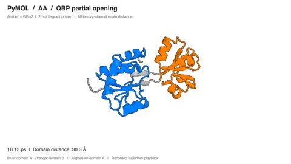
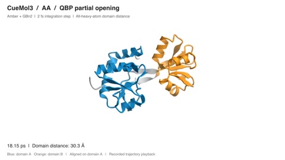
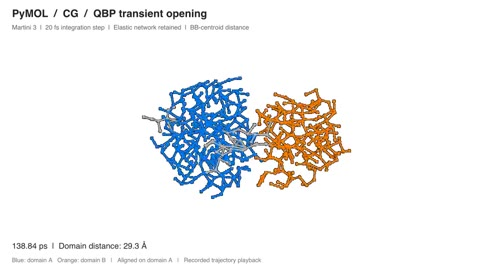
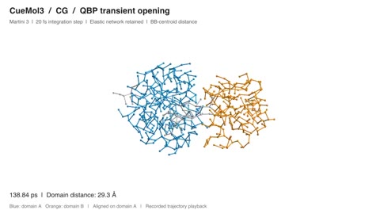
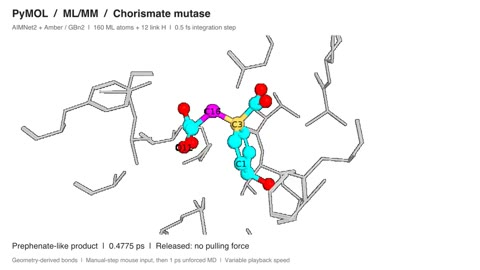
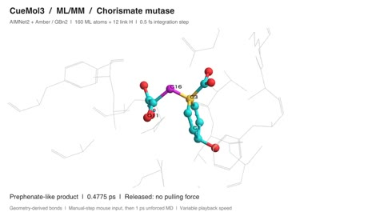

# pymol_imd

Interactive molecular dynamics with **PyMOL** and an experimental **CueMol3**
adapter. Drag atoms in the viewer while OpenMM advances the simulation.

| Level | Model | Typical use |
|---|---|---|
| `aa` | Amber ff14SB / GAFF with AM1-BCC ligand charges | Atomistic proteins, DNA, RNA, lipids and ligands |
| `cg` | Martini 3 | Coarse-grained proteins; 20 fs timestep |
| `mlmm` | Amber MM + an ONIOM MLIP correction | A selected region treated with AIMNet2, MACE, ORB or UMA |

[Videos](#videos) · [Install](#install) · [PyMOL](#pymol) · [CueMol3](#cuemol3-experimental) ·
[Pull settings](#pull-settings)

## Videos

Click a preview to open its MP4. Each clip is 14 seconds, 960 × 540 at 20 fps;
the six videos total about 6.5 MB.

| Recorded motion | PyMOL | CueMol3 |
|---|---|---|
| **AA:** partial QBP opening | [](examples/pymol_aa.mp4) | [](examples/cuemol_aa.mp4) |
| **CG:** transient QBP opening and return | [](examples/pymol_cg.mp4) | [](examples/cuemol_cg.mp4) |
| **ML/MM:** driven chorismate rearrangement | [](examples/pymol_mlmm.mp4) | [](examples/cuemol_mlmm.mp4) |

Both columns replay the same verified physical-mouse trajectories recorded in
PyMOL, rendered independently by each viewer. They are trajectory movies, with
MD time shown on screen. See [conditions and interpretation](examples/README.md#videos).

## Install

Requires [pixi](https://pixi.sh). Run commands from the repository root.
Native platforms are Linux (`linux-64`) and Apple Silicon (`osx-arm64`).
Use WSL2 on Windows or a Linux VM on Intel Mac.

```bash
pixi install
```

This installs all three simulation levels, with **AIMNet2** as the default
MLIP and **MACE** as an alternative. Install ORB or UMA with
`pixi run install-orb` or `pixi run install-uma`. UMA also requires model access;
use `pixi run --no-install` after `install-uma` to retain its dependencies.

## PyMOL

Replace `input.pdb` with your structure. Choose one simulation level:

```bash
# All-atom Amber
pixi run pymol_imd local input.pdb --level aa --minimize

# Coarse-grained Martini 3
pixi run pymol_imd local input.pdb --level cg --minimize

# ML/MM with AIMNet2 on residue 1
pixi run pymol_imd local input.pdb --level mlmm --minimize \
    --ml-selection "resi 1" --ml-charge 0 --ml-mult 1
```

For ML/MM, choose the selection, net charge and spin multiplicity to match
your molecule. These three arguments are required.

| Action | PyMOL control |
|---|---|
| Pull an atom | **Ctrl + left-drag** in the automatically selected Editing mode |
| Pull a residue or chain | `imd_drag_level residue` or `imd_drag_level chain` |
| Return to atom pulling | `imd_drag_level atom` |
| Stop / resume production | `imd_stop` / `imd_run` |
| Change sensitivity and cap | `imd_change const_k=20000, max_force_kj=2500` |

Picked atoms or bonds can change the editing bindings. Click **Unpick** to
restore the usual controls, or follow **MovA** in the lower-right mouse grid.

`local` starts production after setup and optional minimization. Use `launch`
to configure the viewer without starting production, or add `--print-only`
to inspect its generated command.

## CueMol3 (experimental)

Install the CueMol3 Electron app separately. The adapter uses its own profile.

**1. Start the engine in one terminal:**

```bash
pixi run pymol_imd serve input.pdb --level aa --minimize --port 8888
```

**2. Connect the viewer in another terminal:** use the **exact prepared PDB**
printed as `prepared=...` in the server's `IMD_READY` line. Replace the example
path with that file.

```bash
pixi run cuemol connect path/to/prepared.pdb --port 8888
```

The app defaults to `/Applications/CueMol3.app` on macOS. On Linux, the adapter
looks for `cuemol3` or `CueMol3` on `PATH`; on Windows, it looks for `CueMol3.exe`
or `cuemol3.exe` on `PATH`, then checks Program Files and the per-user Programs
directory. Use `--app` to select another installation, or `--endpoint` to
attach to an existing CueMol3 debug instance. `pixi run cuemol launch` uses the
same defaults. The simulation environment on Windows still requires WSL2.

| Action | Upper-right IMD panel |
|---|---|
| Pull an atom | Turn **Pull atoms** on, then plain left-drag from an atom's center |
| Release | Release the mouse; **Escape** also returns to camera navigation |
| Pull a residue or chain | Choose **Drag level**; changing it releases the current pull |
| Move the camera | Turn pulling off for left-drag rotation; right/middle buttons, modifiers and wheel remain available |
| Pause / resume | **Pause / Resume**, which also releases active pulls |
| End the session | **Disconnect**; a viewer started by `connect` closes with its client |

Stop the engine with **Ctrl+C** in its terminal.

- **CG:** use `serve --level cg` and add `--const-k 10000` to `cuemol connect`.
- **ML/MM:** use `serve --level mlmm` with `--ml-selection`, `--ml-charge` and
  `--ml-mult`, as in the PyMOL example.
- **Remote engine:** add `--host` to the client. Trajectories and CSVs are
  recorded by the engine.

Keep perspective disabled while pulling. The adapter currently supports one
visible viewport and one native worker. CueMol3 **2.3.21.544** was physically
tested with AA QBP (3,536 atoms), Martini QBP (528 beads), and an AIMNet2 ML/MM
peptide (33 atoms). Other versions and larger systems remain unverified.

## Pull settings

Drag forces are **uncapped by default** for atom, residue and chain modes in
both viewers. `--const-k` controls the force response to mouse displacement.
An optional per-atom cap can be set with `--max-force-kj` or local PyMOL's
`imd_change`; explicit caps preserve force direction. Socket engines and
clients apply a cap only when explicitly configured.

Residue and chain pulls distribute the group's total force in proportion to
particle mass, giving light and heavy atoms the same pull acceleration.
When an explicit group cap is reached, all its forces scale together.
Use the current server's prepared PDB with the `connect` CLI so socket viewers
receive the actual particle masses, including Martini beads.

MD advances without automatic rollback, velocity resets or retries. There is
no default finite-energy cutoff. Numerical failures, including non-finite
states, unconverged OpenMM distance constraints and invalid ML/MM forces, stop
the run with an error and close the recordings. Failed frames are not written.
`--energy-cutoff-kj` enables an optional energy limit that stops MD when exceeded.

## Simulation defaults and output

- **AA / ML/MM:** GBn2 implicit solvent, NVT, no periodic box. Use
  `--implicit-solvent none` for in-vacuo MD or `--pbc` for PME/NPT without GB.
- **CG:** Martini's cutoff requires a periodic box, which is created
  automatically. `--pbc` additionally enables pressure coupling.
- **Minimization:** `--minimize` relaxes the MM system before production.
  ML/MM corrections are recomputed afterward; there is no equilibration stage.
- **Recording is on by default:** trajectory, applied pull-force CSV and state
  CSV. Use `--no-record` to disable them. Socket output names are unique per
  connection.

## Documentation and checks

Use `pixi run pymol_imd local --help`, `pixi run pymol_imd serve --help`,
or `pixi run cuemol connect --help` to list command options.
See [example structures](examples/README.md) and
[physical mouse experiments](.agents/skills/pymol-imd-mouse-experiments/SKILL.md).

Core checks include `pixi run smoke`, `pixi run smoke-mlmm`,
`pixi run smoke-interactive`, `pixi run smoke-pymol`, `pixi run smoke-socket`,
`pixi run smoke-cuemol` and `pixi run smoke-cuemol-input`.
Headless and scripted checks complement physical mouse verification.

## License

[MIT](LICENSE). OpenMM, PyMOL, CueMol3, vermouth, martini_openmm and the MLIP
models retain their respective licenses; MACE-OMOL-0 is for academic use only.
